<!--
  GitHub profile README for Soham-Prajapati (v3, 2026-11-04).
  Every graphic is a self-hosted SVG in assets/ (no third-party card services that can go down),
  and every one respects prefers-reduced-motion. Menu dishes are separate images so each one is a real link.
-->

<p align="center">
  <a href="https://soham-prajapati.vercel.app"></a>
</p>

I'm **Soham**, also **Shubh**, and online just **Soup**: hence Soup OS, Soupz, and a bowl on everything I ship.

I build AI products end to end, and I don't stop at the demo. At Engaze I architected the MCP layer of a multi-tenant college ERP and wrote **220+ of its 411 tools**, every one permission-checked, so staff run the ERP straight from Claude and ChatGPT.

Then I made the AI do the rest. I wrote the playbook and the **CLAUDE.md / AGENTS.md rules** that stop coding agents from calling a feature done until its MCP tool ships with it, backed by a build that fails the moment permissions drift. Under those rules the agents grew the ERP from **223 to 411 tools** themselves.

I study **Computer Engineering at SPIT Mumbai** with a **UI/UX minor at Pearl Academy**, which is why the things I ship also look like someone cared.

<p align="center">
  
</p>

<p align="center"></p>
<p align="center">
  <a href="https://soupz.vercel.app"></a>
  
  <a href="https://tripwise.prerakgada.in"></a>
  <a href="https://hackfusion-2026.vercel.app"></a>
  <a href="https://prompt-wars-4-by-soup.vercel.app"></a>
  <a href="https://trail-sync-nine.vercel.app"></a>
</p>

### now cooking

```diff
+ a voice-AI scam-call guard for Indian parents, in their own language
+ Séance: your repo's dead code as ghosts you can safely exorcise
```

### the kitchen

<p align="center">
  <sub><b>languages</b></sub><br/>
  
</p>
<p align="center">
  <sub><b>frontend, 3D, mobile &amp; design</b></sub><br/>
  
</p>
<p align="center">
  <sub><b>backend &amp; data</b></sub><br/>
  
</p>
<p align="center">
  <sub><b>ship it</b></sub><br/>
  
</p>
<p align="center">
  
  
  
  
  
  
  
  
  
  
</p>

<p align="center">
  
</p>

<p align="center">
  <a href="https://soham-prajapati.vercel.app">Soup OS</a> ·
  <a href="https://www.linkedin.com/in/soham-prajapati-9-in/">LinkedIn</a> ·
  <a href="https://x.com/_shubhprajapati">X</a> ·
  <a href="https://www.instagram.com/shubh_prajapati99/">Instagram</a> ·
  <a href="https://www.behance.net/gallery/226110415/Spotify-Reimagined">Behance</a> ·
  <a href="mailto:9.sohamprajapati@gmail.com">9.sohamprajapati@gmail.com</a>
</p>
<!-- TODO: link "SN Works" to the studio site once it is live -->
<p align="center"><sub>the other chef in this kitchen: my SN Works co-founder and hackathon teammate → <a href="https://github.com/NidhiiMaru"><b>@NidhiiMaru</b></a></sub></p>

<p align="center"><sub><code>~ made with soup ~</code></sub></p>
